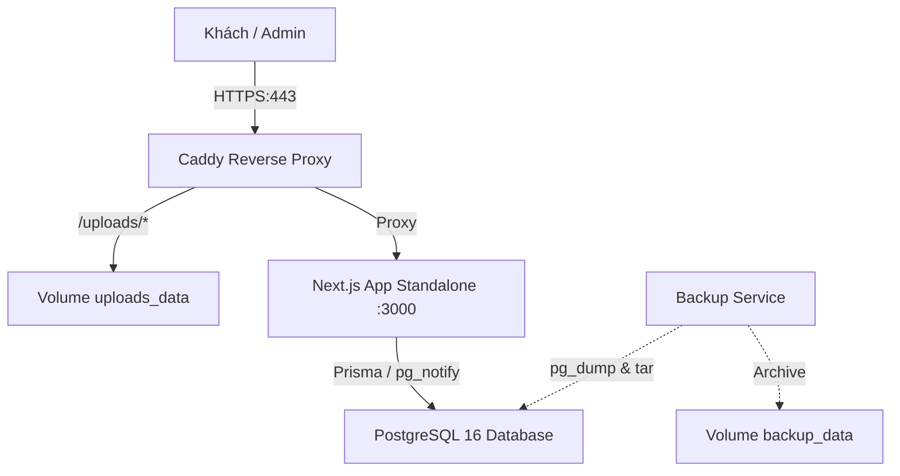

# 🍸 QR Order - Hệ Thống Quản Lý & Gọi Món Quán Bar (Docker Native)

Hệ thống MVP **QR Order** cao cấp được thiết kế chuyên biệt cho mô hình quán Bar / Cocktail Lounge / Pub. Vận hành độc lập 100% bằng Docker, sẵn sàng triển khai trên bất kỳ máy chủ VPS nào mà không cần phụ thuộc dịch vụ đám mây (Cloud-free / Self-hosted).

---

## 📑 Mục Lục
1. [Tính Năng Nổi Bật](#-tính-năng-nổi-bật)
2. [Kiến Trúc & Công Nghệ](#-kiến-trúc--công-nghệ)
3. [Chạy Thử Nghiệm Môi Trường Dev](#-chạy-thử-nghiệm-môi-trường-dev)
4. [Hướng Dẫn Triển Khai Lên VPS (Production)](#-hướng-dẫn-triển-khai-lên-vps-production)
5. [Cập Nhật Phiên Bản Mới](#-cập-nhật-phiên-bản-mới)
6. [Quản Trị Tài Khoản & Phân Quyền](#-quản-trị-tài-khoản--phân-quyền)
7. [Cơ Chế Sao Lưu & Khôi Phục Dữ Liệu](#-cơ-chế-sao-lưu--khôi-phục-dữ-liệu)
8. [Checklist Kiểm Thử End-to-End](#-checklist-kiểm-thử-end-to-end)

---

## 🌟 Tính Năng Nổi Bật

- **Giao diện Khách (`/t/[token]`)**:
  - Giao diện Dark Luxury phong cách quầy bar cao cấp, tối ưu hoàn hảo trên iPhone Safari (tai thỏ, home bar) và Android Chrome.
  - Xem danh mục, tìm kiếm món, thêm giỏ hàng có lưu tạm `localStorage` theo từng token bàn.
  - Gửi đơn gọi món bảo vệ 2 lớp: kiểm tra giá từ database ở server, chống spam Rate Limiting.
  - Cập nhật trạng thái đơn (Đang pha chế, Đã phục vụ, Đã hủy) thời gian thực qua **SSE (Server-Sent Events)** không dùng dịch vụ bên thứ ba.
- **Khu Vực Quản Trị (`/admin`)**:
  - **Bàn & Đơn**: Màn hình tổng quan trạng thái các bàn, drawer xem chi tiết đơn, chuyển trạng thái đơn hàng.
  - **Doanh thu (`/admin/revenue`)**: Biểu đồ doanh thu theo giờ/ngày/tuần/tháng/tùy chọn, danh sách hóa đơn đã chốt, xuất dữ liệu CSV.
  - **Thực đơn (`/admin/menu`)**: Thêm/sửa/xóa/sắp xếp danh mục & món; công tắc "Còn hàng" nhanh; upload ảnh tự động resize WebP 3 kích thước bằng sharp, dọn sạch ảnh cũ khi thay.
  - **Bàn & QR (`/admin/tables`)**: Thêm/sửa/ẩn bàn, hiển thị mã QR động, tải file PNG độ nét cao, vector SVG hoặc tải toàn bộ bàn; trang in A4 chia 4 thẻ đặt bàn sang trọng; nút "Tạo lại token" hủy ngay QR cũ.
  - **Thông tin quán (`/admin/store`)**: Đổi tên quán, logo thương hiệu, bảng chọn màu chủ đạo (Theme Accent) kèm Live Preview điện thoại.
  - **Nhân viên (`/admin/staff`)**: Chỉ Chủ quán (Owner) mới có quyền tạo nhân viên, khóa/mở khóa tài khoản, cấp lại mật khẩu.

---

## 🏗️ Kiến Trúc & Công Nghệ



- **Core**: Next.js 14 App Router, TypeScript (Standalone Output).
- **Styling**: Tailwind CSS, Shadcn UI style, Lucide Icons, Framer Motion.
- **Database**: PostgreSQL 16 (Healthcheck, Partial Unique Index chống trùng session mở).
- **Realtime**: PostgreSQL `LISTEN / NOTIFY` kết hợp SSE (Server-Sent Events) độc lập.
- **Xử lý ảnh**: Sharp WebP 800px / 300px / 1200px.
- **Reverse Proxy**: Caddy 2 (Tự động xin & gia hạn chứng chỉ SSL Let's Encrypt / ZeroSSL, HSTS).
- **Sao lưu**: Container định kỳ nén database `.sql.gz` và thư mục ảnh `.tar.gz` mỗi 24h, giữ 14 bản gần nhất.

---

## 💻 Chạy Thử Nghiệm Môi Trường Dev

### 1. Yêu cầu tiên quyết
- Cài đặt **Docker** và **Docker Compose**.

### 2. Khởi chạy
Chỉ cần chạy lệnh duy nhất:
```bash
docker compose up --build
```
Hệ thống sẽ tự động:
1. Khởi động PostgreSQL 16 và kiểm tra kết nối.
2. Cài đặt dependencies, sinh Prisma Client, chạy `prisma db push`.
3. Tự động seed dữ liệu mẫu: Quán "The Velvet Lounge", 10 bàn, danh mục món ăn & tài khoản quản trị.
4. Mở cổng web tại: **http://localhost:3000**

### 3. Thử nghiệm Lưu trữ S3 cục bộ với MinIO (Tùy chọn)
Mặc định hệ thống sử dụng **Local Storage** (`STORAGE_DRIVER=local`) lưu trong volume `uploads_data`. Nếu bạn muốn thử nghiệm lưu trữ tương thích S3 (MinIO) ngay trên máy cục bộ:
```bash
# Khởi động kèm container MinIO S3
docker compose --profile minio up -d

# Truy cập MinIO Web Console:
# URL: http://localhost:9001
# Username: minioadmin
# Password: minioadmin123
```
Để ứng dụng chuyển sang lưu trữ S3/MinIO, cấu hình trong file `.env`:
```env
STORAGE_DRIVER=s3
S3_ENDPOINT=http://minio:9000
S3_REGION=auto
S3_BUCKET=qrorder-media
S3_ACCESS_KEY_ID=minioadmin
S3_SECRET_ACCESS_KEY=minioadmin123
```

---

## 🚀 Hướng Dẫn Triển Khai Lên VPS (Production)

### Bước 1: Chuẩn bị máy chủ VPS
- Hệ điều hành: Ubuntu 22.04 LTS hoặc mới hơn.
- Cấu hình khuyến nghị: 1 vCPU, 1GB - 2GB RAM.
- Cài đặt Docker & Docker Compose:
  ```bash
  curl -fsSL https://get.docker.com | sh
  sudo usermod -aG docker $USER
  ```

### Bước 2: Cấu hình tên miền (DNS)
- Đăng nhập vào trang quản trị tên miền của bạn (Cloudflare, Namecheap, v.v.).
- Tạo bản ghi **A Record** trỏ tên miền (ví dụ: `bar.tenmiencuaban.vn`) về địa chỉ **IP Public** của VPS.
- Mở cổng tường lửa VPS (UFW):
  ```bash
  sudo ufw allow 80/tcp
  sudo ufw allow 443/tcp
  sudo ufw allow 22/tcp
  sudo ufw enable
  ```

### Bước 3: Đưa mã nguồn lên VPS
```bash
git clone https://github.com/phongdh04/QRorder.git /var/www/qrorder
cd /var/www/qrorder
```

### Bước 4: Thiết lập file môi trường `.env`
Sao chép từ file mẫu:
```bash
cp .env.example .env
nano .env
```
Điền các giá trị thực tế cho quán của bạn:
```env
# 1. Cơ sở dữ liệu PostgreSQL
POSTGRES_USER="qrorder"
POSTGRES_PASSWORD="MatKhauDatabaseManh_987654321"
POSTGRES_DB="qrorder_prod_db"

# 2. Khóa bảo mật phiên JWT (chuỗi ngẫu nhiên dài từ 32 ký tự trở lên)
SESSION_SECRET="ChuoiBiMatNgauNhienDaiItNhat32KyTu123456"

# 3. Tên miền thực tế (Caddy sẽ tự động cấp chứng chỉ HTTPS cho tên miền này)
DOMAIN="bar.tenmiencuaban.vn"

# 4. Thư mục ảnh và lưu trữ
UPLOAD_DIR="/app/public/uploads"
BACKUP_KEEP_COUNT=14
NODE_ENV="production"
```

### Bước 5: Khởi chạy Production
Chạy lệnh khởi động các container production:
```bash
docker compose -f docker-compose.prod.yml up --build -d
```
> **Caddy Reverse Proxy** sẽ tự động liên hệ Let's Encrypt để xin chứng chỉ SSL/TLS miễn phí cho `DOMAIN` của bạn. Database và Next.js app chỉ chạy trong mạng nội bộ an toàn (không mở cổng database ra ngoài Internet).

### Bước 6: Khởi tạo dữ liệu ban đầu
Chạy cập nhật cấu trúc database và seed dữ liệu mẫu:
```bash
docker compose -f docker-compose.prod.yml exec app npx prisma db push
docker compose -f docker-compose.prod.yml exec app npx tsx scripts/seed.ts
```

---

## 🔄 Cập Nhật Phiên Bản Mới

Khi có bản cập nhật code mới từ Git:
```bash
cd /var/www/qrorder
git pull origin main
docker compose -f docker-compose.prod.yml up --build -d
docker compose -f docker-compose.prod.yml exec app npx prisma db push
```

---

## 👤 Quản Trị Tài Khoản & Phân Quyền

Sau khi chạy seed, tài khoản quản trị mặc định:
- **Đường dẫn**: `https://{DOMAIN}/admin/login`
- **Email**: `owner@demobar.vn`
- **Mật khẩu**: `Admin@123456`

### Phân quyền vai trò:
| Vai trò | Quyền hạn |
| :--- | :--- |
| **Chủ quán (Owner)** | Toàn quyền: Xem doanh thu, quản lý thực đơn, bàn & QR, đổi màu giao diện quán, tạo/khóa tài khoản nhân viên, đổi mật khẩu nhân viên. |
| **Nhân viên (Staff)** | Tiếp nhận đơn hàng, đổi trạng thái món (Pha chế / Phục vụ), thanh toán bàn. Bị chặn truy cập trang quản lý nhân viên. |

---

## 💾 Cơ Chế Sao Lưu & Khôi Phục Dữ Liệu

### 1. Tự động sao lưu định kỳ
Container `qrorder_prod_backup` tự động chạy 24 giờ một lần:
- Xuất bản sao lưu cơ sở dữ liệu: `/backups/qrorder_db_YYYYMMDD_HHMMSS.sql.gz`
- Đóng gói toàn bộ hình ảnh tải lên: `/backups/qrorder_uploads_YYYYMMDD_HHMMSS.tar.gz`
- Tự động duy trì 14 bản sao lưu mới nhất và dọn dẹp các bản cũ hơn.

### 2. Kích hoạt sao lưu thủ công tức thì
```bash
docker compose -f docker-compose.prod.yml exec backup sh /backup.sh
```

### 3. Khôi phục dữ liệu từ bản sao lưu
Khi cần khôi phục lại dữ liệu (ví dụ: chuyển sang VPS mới hoặc khôi phục sự cố):

**Cách 1: Tự động khôi phục bản sao lưu mới nhất:**
```bash
docker compose -f docker-compose.prod.yml exec backup sh /scripts/restore.sh
```

**Cách 2: Chỉ định rõ file sao lưu cần khôi phục:**
```bash
docker compose -f docker-compose.prod.yml exec backup sh /scripts/restore.sh qrorder_db_20261013_120000.sql.gz qrorder_uploads_20261013_120000.tar.gz
```

---

## ✅ Checklist Kiểm Thử End-to-End

Quy trình kiểm thử hoàn chỉnh từ lúc khách quét bàn đến khi chốt doanh thu:

```
[1. Quét QR] ──> [2. Chọn món] ──> [3. Gửi đơn] ──> [4. Bar nhận đơn] 
                                                             │
[8. Doanh thu] <── [7. Thanh toán] <── [6. Khách nhận món] <── [5. Pha chế & Phục vụ]
```

1. **Khách quét mã QR**:
   - Dùng camera điện thoại quét mã QR tại bàn hoặc mở link mẫu `https://{DOMAIN}/t/{token}` (ví dụ: Bàn 01).
   - Kiểm tra giao diện hiển thị đúng tên quán, đúng số bàn, menu tải nhanh mượt mà.
2. **Khách chọn món & ghi chú**:
   - Bấm nút "+" để thêm nhanh hoặc bấm vào từng thẻ món để mở Bottom Sheet xem ảnh lớn, ghi chú (ví dụ: *"Ít ngọt, nhiều đá"*).
   - Kiểm tra thanh nổi giỏ hàng cập nhật số lượng và tổng tạm tính chính xác.
3. **Khách gửi đơn**:
   - Bấm mở giỏ hàng, kiểm tra danh sách món, bấm **"Gửi Đơn Gọi Món"**.
   - Kiểm tra modal thành công hiện ra; phiên bàn chuyển sang trạng thái đang phục vụ.
4. **Admin nhận đơn Realtime**:
   - Mở màn hình quản trị tại `https://{DOMAIN}/admin` hoặc `/admin/orders`.
   - Chuông thông báo vang lên và thẻ đơn hàng mới xuất hiện ngay lập tức mà không cần bấm F5.
5. **Nhân viên xử lý đơn**:
   - Bấm chuyển đơn từ **Chờ tiếp nhận (Pending)** sang **Đang pha chế (Preparing)**.
   - Khi hoàn thành, bấm chuyển sang **Đã phục vụ (Served)**.
6. **Khách hàng theo dõi đơn**:
   - Trên điện thoại khách, kiểm tra thẻ "Đơn của bàn" hiển thị trạng thái chuyển sang màu xanh lá (*Đã phục vụ*) theo thời gian thực qua SSE.
7. **Thanh toán bàn**:
   - Tại trang `/admin`, bấm vào bàn cần thanh toán, chọn nút **"Đã thanh toán"**.
   - Hộp thoại thanh toán hiện danh sách món, tổng tiền tính từ database.
   - Chọn phương thức: *Tiền mặt* hoặc *Chuyển khoản*.
   - Bấm xác nhận: Phiên bàn chuyển sang `paid`, giải phóng bàn cho khách tiếp theo. Khách quét lại mã sẽ thấy màn hình cảm ơn.
8. **Kiểm tra thống kê doanh thu**:
   - Vào menu `/admin/revenue`.
   - Kiểm tra tổng doanh thu hôm nay tăng đúng số tiền của hóa đơn vừa chốt.
   - Kiểm tra danh sách hóa đơn hiển thị đầy đủ phương thức thanh toán và giờ thanh toán theo múi giờ Việt Nam (`Asia/Ho_Chi_Minh`).
