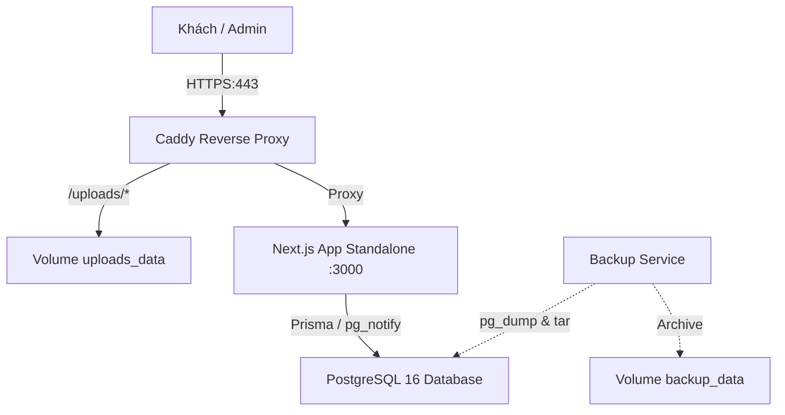

# 🍸 QR Order - Hệ Thống Quản Lý & Gọi Món Quán Bar (Docker Native)

Hệ thống MVP **QR Order** cao cấp được thiết kế chuyên biệt cho mô hình quán Bar / Cocktail Lounge / Pub. Vận hành độc lập 100% bằng Docker, sẵn sàng triển khai trên bất kỳ máy chủ VPS nào mà không cần phụ thuộc dịch vụ đám mây (Cloud-free / Self-hosted).

---

## 📑 Mục Lục
1. [Tính Năng Nổi Bật](#-tính-năng-nổi-bật)
2. [Hệ Thống Nhân Viên PWA & Quản Trị Phân Khu](#-hệ-thống-nhân-viên-pwa--quản-trị-phân-khu)
3. [Cấu Hình Web Push & Khóa VAPID](#-cấu-hình-web-push--khóa-vapid)
4. [Kiến Trúc & Công Nghệ](#-kiến-trúc--công-nghệ)
5. [Chạy Thử Nghiệm Môi Trường Dev](#-chạy-thử-nghiệm-môi-trường-dev)
6. [Quy Trình Triển Khai Cho Quán Mới (Onboarding)](#-quy-trình-triển-khai-cho-quán-mới-onboarding)
7. [Hướng Dẫn Triển Khai Lên VPS (Production)](#-hướng-dẫn-triển-khai-lên-vps-production)
8. [Quản Trị Tài Khoản & Phân Quyền Ma Trận](#-quản-trị-tài-khoản--phân-quyền-ma-trận)
9. [Cơ Chế Sao Lưu & Khôi Phục Dữ Liệu](#-cơ-chế-sao-lưu--khôi-phục-dữ-liệu)
10. [Checklist Kiểm Thử Thực Tế](#-checklist-kiểm-thử-thực-tế)

---

## 🌟 Tính Năng Nổi Bật

- **Giao diện Khách (`/t/[token]`)**:
  - Giao diện Dark Luxury phong cách quầy bar cao cấp, tối ưu hoàn hảo trên iPhone Safari (tai thỏ, home bar) và Android Chrome.
  - Xem danh mục, tìm kiếm món, thêm giỏ hàng có lưu tạm `localStorage` theo từng token bàn.
  - Gửi đơn gọi món bảo vệ 2 lớp: kiểm tra giá từ database ở server, chống spam Rate Limiting.
  - **Nút hành động nhanh mạ vàng**: "Gọi nhân viên" & "Yêu cầu thanh toán" với phản hồi tức thì và rate-limit 60s/bàn.
  - Cập nhật trạng thái đơn (Đang pha chế, Đã phục vụ, Đã hủy) thời gian thực qua **SSE (Server-Sent Events)** không dùng dịch vụ bên thứ ba.
- **Cổng Nhân Viên PWA (`/staff`)**:
  - Ứng dụng PWA di động độc lập (Standalone), hỗ trợ cài đặt trên Android Chrome & iOS Safari (iOS 16.4+).
  - Nút lớn **"Bắt đầu ca"**: Mở khóa âm thanh Web Audio synthesizer, xin quyền Web Push, giữ sáng màn hình (Screen Wake Lock).
  - 3 Tab phân loại công việc: "Chờ nhận" (lọc theo khu + khẩn cấp), "Của tôi", "Khu khác".
  - **Cơ chế Nhận việc nguyên tử (Atomic Claim)**: Chống tranh chấp (race condition) khi 2 nhân viên cùng nhận; phản hồi nhẹ nhàng không báo lỗi đỏ.
  - Đếm thời gian chờ trực tiếp (đổi sang Cam rồi Đỏ nhấp nháy), còi báo lặp lại cho tới khi có người tiếp nhận.
  - **Tự động leo thang (Escalation)** sau 60s: Hú còi khẩn cấp và thông báo cho toàn bộ nhân viên trong ca và Quản lý.
  - Khả năng chịu lỗi mất mạng cao: Tự kết nối lại SSE với backoff, tự động đồng bộ lại toàn bộ danh sách khi mở lại app, heartbeat hiện diện mỗi 20s.
- **Khu Vực Quản Trị (`/admin`)**:
  - **Sơ đồ bàn thông minh (Floor Plan)**: Hiển thị 5 màu trạng thái trực quan: **Đỏ** (Quá hạn chưa ai nhận) > **Cam** (Có việc chờ) > **Vàng** (Đang xử lý) > **Xanh** (Đã xong) > **Xám** (Bàn trống).
  - **Ca & Phân khu (`/admin/shifts`)**: Quản lý khu vực bàn, mở/đóng ca làm việc, phân công nhân viên theo khu vực hoặc linh hoạt toàn quán.
  - **Tài khoản nhân viên (`/admin/staff`)**: Tạo nhân viên, phân quyền 3 cấp (Owner / Manager / Staff), tạo link mời một lần (Single-use invite link) kèm mã QR.
  - **Tờ hướng dẫn nhân viên in A5 (`/admin/staff/guide`)**: Nhập thông tin Wi-Fi quán (tạo chuỗi chuẩn `WIFI:...;;` thoát ký tự đặc biệt, không lưu vào DB), in tờ A5 kèm QR Wi-Fi và QR Staff App.
  - **Doanh thu (`/admin/revenue`)**: Biểu đồ doanh thu theo giờ/ngày/tuần/tháng/tùy chọn, danh sách hóa đơn đã chốt, xuất dữ liệu CSV (chỉ Owner).
  - **Thực đơn (`/admin/menu`)**: Thêm/sửa/xóa/sắp xếp danh mục & món; công tắc "Còn hàng" nhanh; upload ảnh tự động resize WebP 3 kích thước bằng sharp, dọn sạch ảnh cũ khi thay.
  - **Bàn & QR (`/admin/tables`)**: Thêm/sửa/ẩn bàn, hiển thị mã QR động, tải file PNG độ nét cao, vector SVG hoặc tải toàn bộ bàn; trang in A4 chia 4 thẻ đặt bàn sang trọng; nút "Tạo lại token" hủy ngay QR cũ.
  - **Thông tin quán (`/admin/store`)**: Đổi tên quán, logo thương hiệu, bảng chọn màu chủ đạo (Theme Accent) kèm Live Preview điện thoại.

---

## 📱 Hệ Thống Nhân Viên PWA & Quản Trị Phân Khu

Hệ thống nhân viên được xây dựng hoàn toàn theo tiêu chuẩn **Progressive Web App (PWA)** di động:

### 1. Cài đặt trên điện thoại (PWA Standalone)
- **Android (Chrome / Edge)**:
  - Mở `https://{DOMAIN}/staff`.
  - Nhấp vào thanh thông báo nổi *"Cài ứng dụng"* ở chân trang hoặc bấm menu 3 chấm `⋮` chọn *"Cài đặt ứng dụng"*.
- **iPhone / iPad (iOS 16.4 trở lên)**:
  - **Lưu ý bắt buộc**: Apple chỉ cho phép Web Push hoạt động khi app được thêm vào Màn hình chính.
  - Mở bằng **Safari**, bấm biểu tượng **Chia sẻ (Share)** ở thanh điều hướng dưới cùng.
  - Chọn **"Thêm vào MH chính" (Add to Home Screen)**.
  - Đóng Safari và mở ứng dụng từ icon **QR Order** ngoài màn hình chính để đăng nhập.

### 2. Chu trình làm việc trong ca (Shift Workflow)
1. **Bắt đầu ca**: Nhân viên bấm nút lớn *"BẮT ĐẦU CA"* tại `/staff`. Hệ thống tự động:
   - Phát âm thử để mở khóa AudioContext (vượt qua chính sách Autoplay Policy của trình duyệt di động).
   - Đăng ký nhận thông báo đẩy (Web Push) cho thiết bị.
   - Bật giữ sáng màn hình (**Screen Wake Lock**) để không bị tắt màn hình khi quán đông.
2. **Tiếp nhận & Xử lý (Atomic Claim)**:
   - Khi khách gửi đơn, gọi phục vụ hoặc yêu cầu bill, yêu cầu sẽ tự động điều hướng đến nhân viên trực khu vực bàn đó.
   - Nút **"NHẬN"** chạy truy vấn nguyên tử dưới cơ sở dữ liệu `UPDATE ... WHERE status='pending'`. Nếu 2 nhân viên cùng bấm, người bấm sau sẽ nhận thông báo nhẹ nhàng *"Đã có người nhận"* mà không phát sinh lỗi xung đột.
3. **Leo thang tự động (Escalation)**:
   - Nếu sau `escalation_seconds` (mặc định 60 giây) không có nhân viên nào nhận việc, hệ thống kích hoạt chế độ **Khẩn cấp**: Hú còi liên tục, thông báo toàn bộ nhân viên trong ca và Quản lý.
4. **Đã phục vụ**:
   - Khi nhân viên bấm *"ĐÃ PHỤC VỤ"*, toàn bộ việc của bàn hoàn tất, bàn trên sơ đồ quản lý tự động đổi sang màu **XANH LÁ** tức thì.

---

## 🔔 Cấu Hình Web Push & Khóa VAPID

Hệ thống sử dụng chuẩn **Web Push API (VAPID)** độc lập 100%, không phụ thuộc vào Firebase hay bên thứ ba:

### 1. Sinh cặp khóa VAPID
Chạy một trong hai lệnh sau trong thư mục dự án:
```bash
# Bằng npm script
npm run vapid

# Hoặc bằng Makefile
make vapid
```
Lệnh sẽ in ra cặp khóa công khai và riêng tư:
```text
VAPID_PUBLIC_KEY=BLk4_...
VAPID_PRIVATE_KEY=vX8_...
VAPID_SUBJECT=mailto:admin@thevelvet.vn
```

### 2. Cấu hình biến môi trường `.env`
Sao chép các khóa vừa sinh vào file `.env` trên VPS hoặc máy dev:
```env
# Web Push (VAPID)
VAPID_PUBLIC_KEY="<khoa_public>"
VAPID_PRIVATE_KEY="<khoa_private>"
VAPID_SUBJECT="mailto:admin@tenmiencuaban.vn"
```

> ⚠️ **Yêu cầu bắt buộc về HTTPS**:
> - Web Push và Service Worker **bắt buộc chạy trên giao thức HTTPS** (chỉ ngoại lệ với `http://localhost` trong môi trường dev).
> - Khi triển khai production bằng Caddy (`docker-compose.prod.yml`), Caddy sẽ tự động cấp chứng chỉ HTTPS chuẩn, đảm bảo Web Push hoạt động trơn tru.

---

## 🏗️ Kiến Trúc & Công Nghệ



- **Core**: Next.js 14 App Router, TypeScript (Standalone Output).
- **Styling**: Tailwind CSS, Shadcn UI style, Lucide Icons, Framer Motion.
- **Database**: PostgreSQL 16 (Healthcheck, Partial Unique Index chống trùng session mở).
- **Realtime**: PostgreSQL `LISTEN / NOTIFY` kết hợp SSE (Server-Sent Events) độc lập.
- **Xử lý ảnh**: Sharp WebP 800px / 300px / 1200px.
- **Reverse Proxy**: Caddy 2 (Tự động xin & gia hạn chứng chỉ SSL Let's Encrypt / ZeroSSL, HSTS).
- **Sao lưu**: Container định kỳ nén database `.sql.gz` và thư mục ảnh `.tar.gz` mỗi 24h, giữ 14 bản gần nhất.

---

## 💻 Chạy Thử Nghiệm Môi Trường Dev

### 1. Yêu cầu tiên quyết
- Cài đặt **Docker** và **Docker Compose**.

### 2. Khởi chạy
Chỉ cần chạy lệnh duy nhất:
```bash
docker compose up --build
```
Hệ thống sẽ tự động:
1. Khởi động PostgreSQL 16 và kiểm tra kết nối.
2. Cài đặt dependencies, sinh Prisma Client, chạy `prisma db push`.
3. Tự động seed dữ liệu mẫu: Quán "The Velvet Lounge", 10 bàn, danh mục món ăn & tài khoản quản trị.
4. Mở cổng web tại: **http://localhost:3000**

### 3. Thử nghiệm Lưu trữ S3 cục bộ với MinIO (Tùy chọn)
Mặc định hệ thống sử dụng **Local Storage** (`STORAGE_DRIVER=local`) lưu trong volume `uploads_data`. Nếu bạn muốn thử nghiệm lưu trữ tương thích S3 (MinIO) ngay trên máy cục bộ:
```bash
# Khởi động kèm container MinIO S3
docker compose --profile minio up -d

# Truy cập MinIO Web Console:
# URL: http://localhost:9001
# Username: minioadmin
# Password: minioadmin123
```
Để ứng dụng chuyển sang lưu trữ S3/MinIO, cấu hình trong file `.env`:
```env
STORAGE_DRIVER=s3
S3_ENDPOINT=http://minio:9000
S3_REGION=auto
S3_BUCKET=qrorder-media
S3_ACCESS_KEY_ID=minioadmin
S3_SECRET_ACCESS_KEY=minioadmin123
```

---

## 🚀 Hướng Dẫn Triển Khai Lên VPS (Production)

### Bước 1: Chuẩn bị máy chủ VPS
- Hệ điều hành: Ubuntu 22.04 LTS hoặc mới hơn.
- Cấu hình khuyến nghị: 1 vCPU, 1GB - 2GB RAM.
- Cài đặt Docker & Docker Compose:
  ```bash
  curl -fsSL https://get.docker.com | sh
  sudo usermod -aG docker $USER
  ```

### Bước 2: Cấu hình tên miền (DNS)
- Đăng nhập vào trang quản trị tên miền của bạn (Cloudflare, Namecheap, v.v.).
- Tạo bản ghi **A Record** trỏ tên miền (ví dụ: `bar.tenmiencuaban.vn`) về địa chỉ **IP Public** của VPS.
- Mở cổng tường lửa VPS (UFW):
  ```bash
  sudo ufw allow 80/tcp
  sudo ufw allow 443/tcp
  sudo ufw allow 22/tcp
  sudo ufw enable
  ```

### Bước 3: Đưa mã nguồn lên VPS
```bash
git clone https://github.com/phongdh04/QRorder.git /var/www/qrorder
cd /var/www/qrorder
```

### Bước 4: Thiết lập file môi trường `.env`
Sao chép từ file mẫu:
```bash
cp .env.example .env
nano .env
```
Điền các giá trị thực tế cho quán của bạn:
```env
# 1. Cơ sở dữ liệu PostgreSQL
POSTGRES_USER="qrorder"
POSTGRES_PASSWORD="MatKhauDatabaseManh_987654321"
POSTGRES_DB="qrorder_prod_db"

# 2. Khóa bảo mật phiên JWT (chuỗi ngẫu nhiên dài từ 32 ký tự trở lên)
SESSION_SECRET="ChuoiBiMatNgauNhienDaiItNhat32KyTu123456"

# 3. Tên miền thực tế (Caddy sẽ tự động cấp chứng chỉ HTTPS cho tên miền này)
DOMAIN="bar.tenmiencuaban.vn"

# 4. Thư mục ảnh và lưu trữ
UPLOAD_DIR="/app/public/uploads"
BACKUP_KEEP_COUNT=14
NODE_ENV="production"
```

### Bước 5: Khởi chạy Production
Chạy lệnh khởi động các container production:
```bash
docker compose -f docker-compose.prod.yml up --build -d
```
> **Caddy Reverse Proxy** sẽ tự động liên hệ Let's Encrypt để xin chứng chỉ SSL/TLS miễn phí cho `DOMAIN` của bạn. Database và Next.js app chỉ chạy trong mạng nội bộ an toàn (không mở cổng database ra ngoài Internet).

### Bước 6: Khởi tạo dữ liệu ban đầu
Chạy cập nhật cấu trúc database và seed dữ liệu mẫu:
```bash
docker compose -f docker-compose.prod.yml exec app npx prisma db push
docker compose -f docker-compose.prod.yml exec app npx tsx scripts/seed.ts
```

---

## 🔄 Cập Nhật Phiên Bản Mới

Khi có bản cập nhật code mới từ Git:
```bash
cd /var/www/qrorder
git pull origin main
docker compose -f docker-compose.prod.yml up --build -d
docker compose -f docker-compose.prod.yml exec app npx prisma db push
```

---

## 📋 Quy Trình Triển Khai Cho Quán Mới (Onboarding)

Khi triển khai hệ thống cho một nhà hàng / quán bar mới:

1. **Khởi tạo thông tin quán & tài khoản Chủ quán (Owner)**:
   - Chạy lệnh seed hoặc script tạo nhà hàng kèm cấu hình thời gian leo thang (`escalation_seconds`: 60) và cảnh báo offline (`offline_alert_seconds`: 120).
   - Thiết lập tài khoản Owner ban đầu.
2. **Thiết lập Sơ đồ phân khu & Gán bàn**:
   - Chủ quán/Quản lý đăng nhập vào `/admin/shifts` (Ca & Phân khu).
   - Tạo các khu vực bàn thực tế của quán (ví dụ: *Tầng 1 - Quầy Bar*, *Tầng 2 - Lounge*, *Khu Ngoài trời*).
   - Gán từng bàn vào khu vực tương ứng để nhân viên phụ trách nhận đúng thông báo.
3. **Mời nhân viên gia nhập hệ thống**:
   - Quản lý vào `/admin/staff`, nhấn **"Tạo liên kết mời"** (Single-use Invite Link).
   - Hệ thống sinh mã ngẫu nhiên mạnh, chỉ lưu bản băm (SHA-256) trên database và hết hạn sau 24 giờ.
   - Quản lý đưa mã QR mời trên màn hình cho nhân viên quét hoặc gửi liên kết `/invite/[token]`.
   - Nhân viên tự đặt mật khẩu và đăng nhập trực tiếp vào `/staff`.
4. **In Tờ hướng dẫn nhân viên (Khổ A5)**:
   - Quản lý vào trang `/admin/staff/guide`.
   - Nhập thông tin Wi-Fi nội bộ của quán (SSID và Mật khẩu). Trình duyệt sẽ sinh mã QR Wi-Fi theo chuẩn quốc tế `WIFI:T:WPA;S:...;P:...;;` (không lưu mật khẩu Wi-Fi vào database).
   - Nhấn **"In tờ hướng dẫn A5"** để dán trong khu vực pha chế / phòng nghỉ nhân viên.
5. **Vận hành ca làm việc (Shift Operations)**:
   - Đầu ca, Quản lý vào `/admin/shifts` nhấn **"Bắt đầu ca mới"**, phân công nhân viên vào các khu vực (hoặc để trống khu vực để phụ trách linh hoạt toàn quán).
   - Nhân viên mở điện thoại, kết nối Wi-Fi nội bộ, mở app `/staff` và nhấn **"BẮT ĐẦU CA"**.

---

## 👤 Quản Trị Tài Khoản & Phân Quyền Ma Trận

Hệ thống triển khai ma trận phân quyền tập trung tại `src/lib/permissions.ts`, kiểm tra nghiêm ngặt ở cấp độ Server cho mọi API và trang:

### Ma trận quyền hạn:
| Nhóm quyền / Thao tác | Nhân viên (Staff) | Quản lý (Manager) | Chủ quán (Owner) |
| :--- | :---: | :---: | :---: |
| **Xem việc khu vực được giao** | ✅ | ✅ | ✅ |
| **Nhận việc / Nhả việc** | ✅ | ✅ | ✅ |
| **Báo "Đã phục vụ"** | ✅ | ✅ | ✅ |
| **Xem việc toàn quán (sau khi escalate)** | ✅ | ✅ | ✅ |
| **Xem sơ đồ bàn & trạng thái nhân viên** | ❌ | ✅ | ✅ |
| **Phân công lại việc (Reassign)** | ❌ | ✅ | ✅ |
| **Hủy đơn (bắt buộc nhập lý do)** | ❌ | ✅ | ✅ |
| **Thanh toán bàn** | Cờ cấu hình* | ✅ | ✅ |
| **Mở ca / Kết thúc ca làm việc** | ❌ | ✅ | ✅ |
| **Tạo / Khóa tài khoản Staff** | ❌ | ✅ | ✅ |
| **Tạo / Khóa tài khoản Manager** | ❌ | ❌ | ✅ |
| **Xem thống kê Doanh thu** | ❌ | ❌ | ✅ |
| **Quản lý Thực đơn & Bàn** | ❌ | ❌ | ✅ |
| **Cấu hình thông tin quán & Giao diện** | ❌ | ❌ | ✅ |
| **Mở lại hóa đơn đã chốt (Reopen bill)** | ❌ | ❌ | ✅ |

*\*Ghi chú: Cờ cấu hình `PERMISSION_FLAGS.STAFF_CAN_PAY_BILLS` trong `src/lib/permissions.ts` mặc định tắt (`false`). Khi bật `true`, nhân viên có thể bấm nút "Đã thanh toán" tại bàn.*

> 🔒 **Cơ chế Thu hồi Quyền tức thì (Immediate Revocation)**:
> Khi một tài khoản bị khóa (`is_active = false`), mọi phiên đăng nhập của tài khoản đó bị vô hiệu hóa ngay lập tức ở request tiếp theo, đồng thời toàn bộ Web Push Subscription trên các thiết bị của tài khoản sẽ tự động bị xóa bỏ.

---

## 📦 Quản Trị Gói Dịch Vụ & Hạn Mức Ảnh (Hệ Thống)

Quản trị viên hệ thống có thể kiểm tra và thay đổi gói dịch vụ (`basic` | `pro`), hạn mức số ảnh và tổng dung lượng lưu trữ của từng nhà hàng thông qua công cụ CLI:

### 1. Xem danh sách nhà hàng và dung lượng sử dụng:
```bash
docker compose exec app npx tsx scripts/manage-restaurant-plan.ts list
```

### 2. Thay đổi gói dịch vụ của quán (áp dụng hạn mức mặc định):
- **Gói Basic**: Tối đa 30 ảnh, dung lượng 20MB.
- **Gói Pro**: Tối đa 200 ảnh, dung lượng 150MB.
```bash
# Nâng cấp lên gói PRO
docker compose exec app npx tsx scripts/manage-restaurant-plan.ts set <id-hoặc-slug> pro

# Đổi về gói BASIC
docker compose exec app npx tsx scripts/manage-restaurant-plan.ts set <id-hoặc-slug> basic
```

### 3. Tùy chỉnh hạn mức riêng biệt hoặc chuyển chế độ hiển thị:
```bash
# Cấp hạn mức đặc biệt: tối đa 500 ảnh, 300MB
docker compose exec app npx tsx scripts/manage-restaurant-plan.ts set <id-hoặc-slug> pro --images 500 --bytes 300

# Chuyển chế độ hiển thị menu (photo hoặc minimal)
docker compose exec app npx tsx scripts/manage-restaurant-plan.ts set <id-hoặc-slug> basic --mode minimal
```

---

## 🌐 Cấu Hình Cloudflare CDN & Tối Ưu Cache (Khuyên Dùng)

Khi triển khai thực tế trên VPS, đặt **Cloudflare (Gói miễn phí - Free Tier)** phía trước tên miền sẽ giúp VPS gần như **không phải gánh băng thông ảnh**, chống DDoS và tăng tốc độ tải ảnh cho khách:

### 1. Bật Proxy Cloudflare
- Trong trang quản trị DNS Cloudflare, bản ghi `A` trỏ về VPS phải bật **Proxied** (Biểu tượng đám mây màu cam ☁️).
- Vào **SSL/TLS** -> Chọn chế độ mã hóa **Full** hoặc **Full (strict)** để mã hóa đầu cuối giữa Cloudflare và Caddy.

### 2. Thiết lập Cache Rules (Tối ưu hóa bộ đệm ảnh)
Vào mục **Caching** -> **Cache Rules** -> Chọn **Create rule**:
- **Quy tắc 1: Cache vĩnh viễn hình ảnh tĩnh (Edge Cache)**
  - Tên quy tắc: `Cache Uploads Images`
  - Biểu thức (Rule): `When incoming requests match: URI Path starts with "/uploads/"`
  - Hành động (Cache eligibility): **Eligible for cache**
  - Cài đặt bổ sung:
    - **Edge TTL**: *Ignore cache-control header and use TTL: 1 month* (hoặc 1 year)
    - **Browser TTL**: *Respect origin (origin trả 1 năm)*
    - **Serve stale content**: *Enable*
- **Quy tắc 2: Không cache các route quản trị và API động (Bypass)**
  - Tên quy tắc: `Bypass Dynamic Routes`
  - Biểu thức (Rule): `URI Path starts with "/api/" OR URI Path starts with "/admin/"`
  - Hành động: **Bypass cache**

> ⚠️ **Lưu ý quan trọng về SSE (Server-Sent Events)**:
> Đường dẫn thông báo đơn `/api/sse/*` và `/api/customer/orders/sse` hoạt động tốt trên Cloudflare Proxy. Không bật tính năng *Auto Minify* hoặc *Rocket Loader* cho các URL API để tránh ngắt quãng luồng SSE.

---

## 💾 Cơ Chế Sao Lưu & Khôi Phục Dữ Liệu

> 💡 **Lưu ý về sao lưu tệp ảnh**:
> - **Khi dùng Local Storage (`STORAGE_DRIVER=local`)**: Thư mục ảnh nằm trong Docker Volume `uploads_data`, được tự động nén định kỳ thành file `.tar.gz` kèm database.
> - **Khi dùng S3 / Cloudflare R2 (`STORAGE_DRIVER=s3`)**: Toàn bộ tệp ảnh được lưu trữ an toàn trên đám mây. Bạn nên bật tính năng **Bucket Object Versioning** và **Lifecycle Rules** trực tiếp trên bảng điều khiển của AWS S3 / Cloudflare R2 mà không cần tốn dung lượng ổ đĩa VPS để sao lưu volume local.

### 1. Tự động sao lưu định kỳ
Container `qrorder_prod_backup` tự động chạy 24 giờ một lần:
- Xuất bản sao lưu cơ sở dữ liệu: `/backups/qrorder_db_YYYYMMDD_HHMMSS.sql.gz`
- Đóng gói toàn bộ hình ảnh tải lên: `/backups/qrorder_uploads_YYYYMMDD_HHMMSS.tar.gz` (nếu dùng local)
- Tự động duy trì 14 bản sao lưu mới nhất và dọn dẹp các bản cũ hơn.

### 2. Kích hoạt sao lưu thủ công tức thì
```bash
docker compose -f docker-compose.prod.yml exec backup sh /backup.sh
```

### 3. Khôi phục dữ liệu từ bản sao lưu
Khi cần khôi phục lại dữ liệu (ví dụ: chuyển sang VPS mới hoặc khôi phục sự cố):

**Cách 1: Tự động khôi phục bản sao lưu mới nhất:**
```bash
docker compose -f docker-compose.prod.yml exec backup sh /scripts/restore.sh
```

**Cách 2: Chỉ định rõ file sao lưu cần khôi phục:**
```bash
docker compose -f docker-compose.prod.yml exec backup sh /scripts/restore.sh qrorder_db_20261013_120000.sql.gz qrorder_uploads_20261013_120000.tar.gz
```

---

## ✅ Checklist Kiểm Thử Thực Tế

### 1. Kiểm thử Toàn trình Khách hàng & Quản lý:
Quy trình từ lúc khách quét bàn đến khi chốt doanh thu:

```
[1. Quét QR] ──> [2. Chọn món] ──> [3. Gửi đơn / Gọi nhân viên] ──> [4. Staff PWA Nhận việc] 
                                                                               │
[8. Doanh thu] <── [7. Thanh toán] <── [6. Bàn đổi XANH realtime] <── [5. Báo "Đã phục vụ"]
```

1. **Khách quét mã QR & Gọi món**:
   - Quét mã QR tại bàn `https://{DOMAIN}/t/{token}` (ví dụ: Bàn 01).
   - Chọn món, ghi chú, gửi đơn. Thử nút "Gọi nhân viên" và "Yêu cầu thanh toán".
2. **Staff PWA tiếp nhận nguyên tử**:
   - Mở `/staff` trên điện thoại (đã bấm "Bắt đầu ca").
   - Nhận thông báo âm thanh & rung. Thẻ đơn đếm ngược thời gian.
   - Bấm "NHẬN" → Thẻ chuyển sang "Của tôi", món chuyển sang trạng thái "Đang pha chế".
3. **Phục vụ & Sơ đồ bàn realtime**:
   - Nhân viên bấm "ĐÃ PHỤC VỤ" → Đơn hoàn tất.
   - Trên màn hình Quản lý `/admin`, bàn tự động chuyển màu **XANH LÁ** ngay lập tức mà không cần F5.
4. **Thanh toán & Doanh thu**:
   - Quản lý bấm "Đã thanh toán" tại bàn.
   - Doanh thu nhảy số chính xác tại `/admin/revenue`.

### 2. Checklist Kiểm thử Chi Tiết Trên Máy Thật:
Xem tài liệu đầy đủ tại: **[MANUAL_TESTING_CHECKLIST.md](./MANUAL_TESTING_CHECKLIST.md)**
- [x] Cài đặt PWA trên Android (Chrome) & iPhone Safari (iOS 16.4+ Standalone).
- [x] Nhận Web Push Notification khi khóa màn hình điện thoại.
- [x] Race condition: Hai nhân viên cùng bấm "NHẬN" (1 người thành công, 1 người nhận thông báo êm dịu).
- [x] Tự động leo thang (Escalation) sau 60s: Còi báo động hú, chuyển cho toàn ca và quản lý.
- [x] Mất mạng và tự phục hồi dữ liệu khi có mạng lại mà không sót đơn.
- [x] Khóa tài khoản nhân viên: Hủy ngay phiên làm việc và hủy đăng ký Push Notification.
- [x] In tờ hướng dẫn A5 và quét kết nối Wi-Fi tự động.

